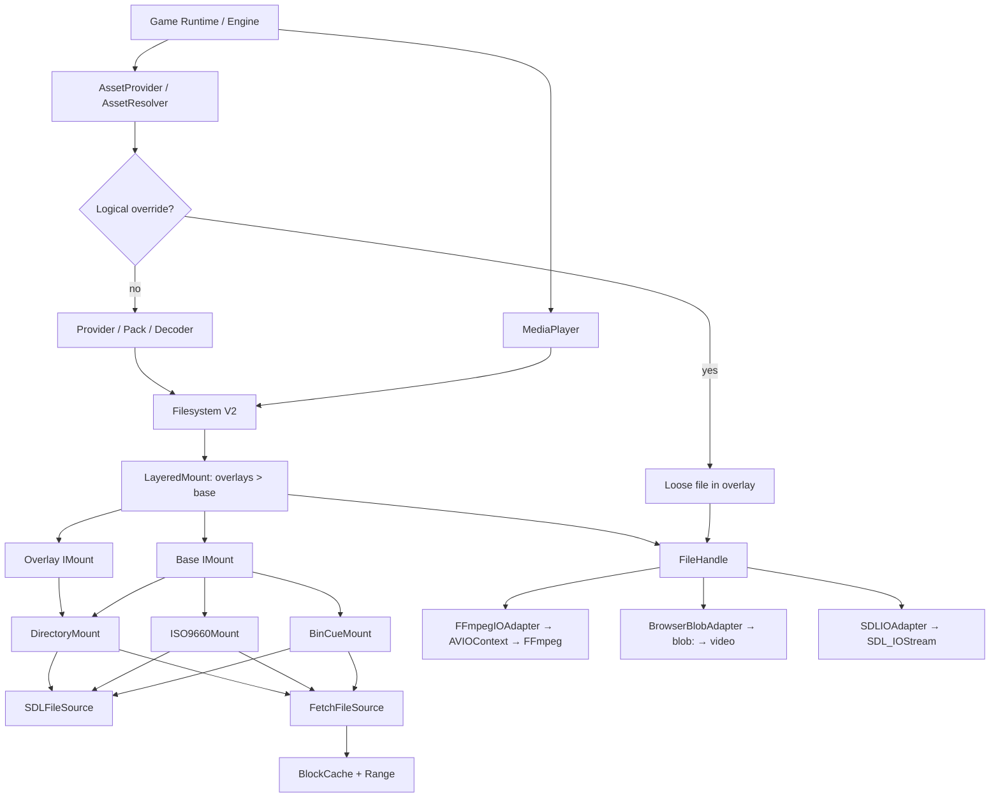
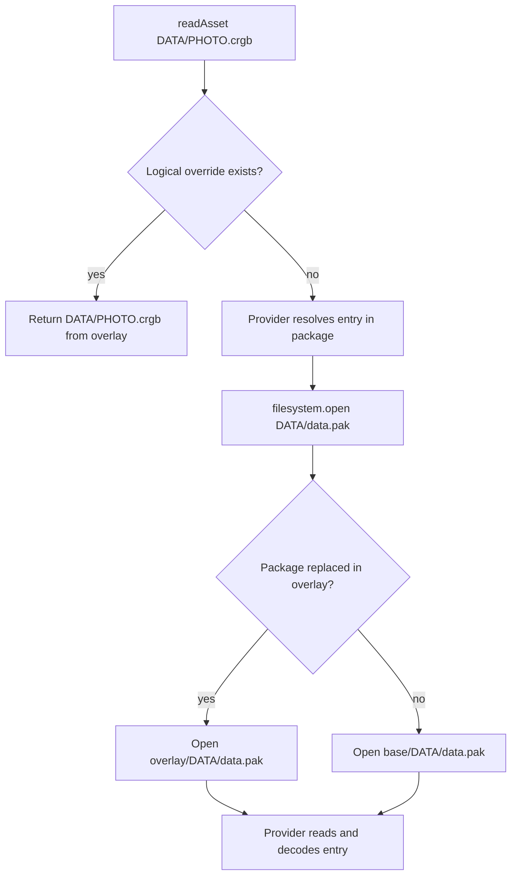

# Kotonoha Engine — Filesystem V2

> **Implementation document for AI agents / C++ engineers**
> **Status:** architecture specification and migration plan; it **does not** mean the APIs proposed here already exist.
> **Repository:** https://github.com/Ruaneri-Portela/Kotonoha
> **Recommended location inside the repository:** `docs/filesystem/README.md`
> **Goal:** consolidate engine resource reading into a virtual Filesystem, independent of the source, with two-level overlays, disk-file mounts, SDL3/Fetch reading and adapters for FFmpeg and the browser.

---

## 0. Mandatory instructions for the implementing agent

This document is a **product and architecture specification**, not a ready-made patch. Before editing the project:

1. **Inspect the real checkout tree**, current signatures and their callers. Do not invent paths or assume classes or functions in this document already exist.
2. Read `README.md`, `docs/ASSET_OVERLAYS.md`, `docs/DIRECTORY_POLICY.md`, `lib/include/Kotonoha/core/FileSystem.hpp`, its implementation and related tests. Also check the WebAssembly documentation and the Xcode/Android projects.
3. Locate `AssetProvider`, `FileSystemAssetProvider`, `IndexedFileSystemAssetProvider`, `MediaPlayer`, ISO/PS2 readers, `SummerAssets`, `Pack` and game initializations using `rg`/structural search. Record the **effective** location of each one in the checkout.
4. **Reuse existing code** for ISO reading, path resolution and overlays. Do not create another parallel implementation of the same behaviors.
5. Work in small phases, each compilable/testable. Do not remove a public contract before migrating callers and adding equivalent tests.
6. Preserve project formatting (`.clang-format`, `.editorconfig`); do not reformat vendored libraries or alter commercial assets.
7. When the specification requires something the current checkout contradicts, document the difference, propose the smallest compatible adaptation and validate with tests. **Do not mark as done what has not been implemented and tested.**
8. At the end of each phase, report: changed files, new/removed APIs, build/test commands executed, results, limitations and remaining tasks.

**Contract priority:** security and data integrity > existing overlay rules > synchronous API required by the project > port compatibility > optimizations.

### Existing reference sources

- [Main README](https://github.com/Ruaneri-Portela/Kotonoha/blob/main/README.md) — engine structure, platforms, game ports and current ISO policy.
- [Overlay contract](https://github.com/Ruaneri-Portela/Kotonoha/blob/main/docs/ASSET_OVERLAYS.md) — override precedence, logical names, aliases, cache and security.
- [Directory policy](https://github.com/Ruaneri-Portela/Kotonoha/blob/main/docs/DIRECTORY_POLICY.md) — per-platform roots and separation between assets and saves.
- [Current paths/storage header](https://github.com/Ruaneri-Portela/Kotonoha/blob/main/lib/include/Kotonoha/core/FileSystem.hpp).
- [Current paths/storage implementation](https://github.com/Ruaneri-Portela/Kotonoha/blob/main/lib/src/core/FileSystem.cpp).
- [Official FFmpeg custom AVIO example](https://github.com/FFmpeg/FFmpeg/blob/master/doc/examples/avio_read_callback.c).

**Scope note:** the repository's public documentation was consulted while preparing this plan, but not every provider/media `.cpp` was audited line by line. The agent must complete that local audit before choosing the exact change points.

---

## 1. Goal and non-negotiable principles

Implement `Kotonoha::Filesystem::Filesystem` as the **single data-reading abstraction for game data**.

- The Filesystem receives **one source**: a local directory, a mountable local file, an HTTP directory with an index, or a remote mountable file.
- Local sources are normalized to absolute local paths; remote sources to absolute URLs (do not confuse a URL with a `std::filesystem::path`).
- Local file I/O uses **SDL3 (`SDL_IOStream`)**; do not implement the local backend with `std::ifstream`/`FILE*`/POSIX `read` directly. `std::filesystem` may assist with paths, metadata and local directory validation as appropriate for the project.
- HTTP I/O uses **Fetch** on Emscripten, preferably `Range` for large files; do not depend on the Emscripten VFS/preload as the foundation of the remote layer.
- The **public C++ read/seek interface is synchronous**. The mechanism that makes it work with Fetch must respect browser execution constraints; never pretend that JS `fetch()` is blocking on the main thread.
- An ISO or BIN/CUE exposes **virtual files** (`open`, `stat`, `list`, `exists`) without extracting the whole image. Mounts operate over generic byte sources.
- Providers interpret CMP/PAK/RPA/DAT and game-specific formats. The Filesystem **does not know proprietary asset formats**.
- Overlays form **a second tree with the same `game-assets` layout**, visible at **two points**: logical asset replacement and source-file replacement.
- FFmpeg for engine-managed files uses exclusively an **`AVIOContext`** derived from `FileHandle`; it **never** receives a physical path or source URL.
- `HTMLVideoElement` receives a **`blob:`** URL produced from bytes coming from `FileHandle`, **not** the original HTTP URL.
- Saves/configuration/documents remain under the existing persistent-storage policy, **outside the asset overlay**, with no VFS writes in the first version.
- Each virtual file may have no OS path. Do not offer `std::filesystem::path` as the universal representation of an asset.

### Non-goals of the first version

- Writing/editing ISOs or files internal to mounts.
- A generic mounting system for any proprietary format.
- Replacing codecs or decoders.
- Guaranteeing seekable HTTP streaming on servers without Range support.
- Hot-reloading all packages and caches without an explicit policy.
- UDF, full CD audio, every RAW disk mode, ZIP/7z or TAR before the basic milestones.
- Converting `.mpg` into something the browser supports merely by putting the bytes in a Blob.

---

## 2. Architecture overview



**Conceptual separations:**

| Component | What it knows | What it must not know |
| --- | --- | --- |
| `StoragePaths` | resource roots, game-assets, documents and saves per platform | ISO contents, packages, network |
| `Path`/`PathResolver` | normalization and validation of virtual paths | how the asset is encoded |
| `IFileSource` | opening a byte resource (SDL/Fetch) | ISO/CMP structure |
| `IMount` | indexing/exposing a virtual file tree | who consumes the content |
| `LayeredMount` | precedence and merging of the source tree | logical IDs of files inside packages |
| `FileHandle` | read/seek/tell/size | original URL or decoder |
| `AssetProvider` | specific formats and logical asset resolution | physical Fetch/SDL implementation |
| `FFmpegIOAdapter` | AVIO callbacks and ownership | physical origin of the file |
| `BrowserBlobAdapter` | byte transfer and Blob lifecycle | which ISO the file came from |

---

## 3. Target file structure

**Proposed structure; create only the modules actually needed in each phase.** Adjust names to the checkout style, keeping responsibility unambiguous.

```text
lib/
├── include/Kotonoha/
│   └── Filesystem/
│       ├── README.md                   # optional: module summary
│       ├── Filesystem.hpp
│       ├── FileHandle.hpp
│       ├── FileInfo.hpp
│       ├── FilesystemError.hpp
│       ├── Path.hpp
│       ├── StoragePaths.hpp           # former core/FileSystem.hpp, renamed
│       ├── IFileSource.hpp
│       ├── IMount.hpp
│       ├── SourceDetector.hpp
│       ├── MountRegistry.hpp
│       ├── Sources/
│       │   ├── SDLFileSource.hpp
│       │   └── FetchFileSource.hpp
│       ├── Mounts/
│       │   ├── DirectoryMount.hpp
│       │   ├── RemoteDirectoryMount.hpp
│       │   ├── ISO9660Mount.hpp
│       │   ├── BinCueMount.hpp
│       │   ├── LayeredMount.hpp
│       │   └── TarMount.hpp           # future
│       ├── Cache/
│       │   ├── BlockCache.hpp
│       │   └── CachePolicy.hpp
│       └── Adapters/
│           ├── SDLIOAdapter.hpp
│           ├── FFmpegIOAdapter.hpp
│           └── BrowserBlobAdapter.hpp
└── src/
    └── Filesystem/
        ├── Filesystem.cpp
        ├── Path.cpp
        ├── StoragePaths.cpp
        ├── SourceDetector.cpp
        ├── MountRegistry.cpp
        ├── Sources/...
        ├── Mounts/...
        ├── Cache/...
        └── Adapters/...
```

### Naming rule for the legacy header

Move **conceptually** `lib/include/Kotonoha/core/FileSystem.hpp` and `lib/src/core/FileSystem.cpp` to `Filesystem/StoragePaths.hpp/.cpp`.

Among others, the current header publishes `StoragePlatform`, `StorageLocations`, `DirectoryLayout`, `directoryLayout`, `applicationDirectories`, `referenceCandidates`, `resourceDirectory`, `gameAssetDirectory`, `preferredDataDirectory`, `saveDirectory`, `documentsDirectory`, `FileResolver` and `writeTextFileAtomically`.

**Caution:** this set also contains source-lookup helpers and even font APIs. The agent must decide whether some functions deserve separate classes (`ResourceLocator`, `FontResources`) **without expanding the scope of the first migration**. The initial decision is to keep all functionality and behavior in the new `StoragePaths` unit, without rewriting the policy.

Safe migration:

1. Create `Kotonoha/Filesystem/StoragePaths.hpp` and move the corresponding implementation.
2. **Temporarily** preserve the existing symbols in `namespace Kotonoha` to avoid a mass binary change. Optionally add a `Kotonoha::Filesystem::StoragePaths` facade delegating to the old functions.
3. Make `<Kotonoha/core/FileSystem.hpp>` a compatibility *shim* header that includes the new header; avoid two implementations/definitions.
4. Update includes gradually; remove the shim only when all targets/ports and tests have migrated.
5. **Do not** confuse `StoragePaths` (path and save policy) with `Filesystem` (virtual mounting/reading).

---

## 4. Minimum C++ contracts (proposals, not existing APIs)

### 4.1. Path and file identification

All `IMount` paths are **relative to the virtual root**, using `/`, with no `/` prefix, no `..` and a single normalized representation. Directories use `""` as the virtual root. Avoid leaking physical paths through the API.

```cpp
namespace Kotonoha::Filesystem {

enum class SeekOrigin { Begin, Current, End };
enum class FileType { Regular, Directory };

struct FileInfo {
    std::string path;  // normalized virtual path
    FileType type;
    int64_t size = -1; // -1 if unavailable
};

class FileHandle {
public:
    virtual ~FileHandle() = default;
    virtual int64_t read(void* dst, size_t count) = 0;
    virtual int64_t seek(int64_t offset, SeekOrigin origin) = 0;
    virtual int64_t tell() const = 0;
    virtual int64_t size() const = 0;
};

} // namespace Kotonoha::Filesystem
```

**Mandatory semantics:** `read()` returns `>0` bytes read, `0` only at EOF, `<0` on error (or adopt an equivalent explicit error type); no failed remote read is converted into EOF. `seek()` returns the absolute position on success and an error for an invalid offset. `size()` returns a valid size or a clearly typed error. Handle overflow and files >2 GiB. Handles are independent and RAII; mounts/sources share enough ownership to outlive any open handle.

**Preferred architecture option for mounts:** a byte source with `readAt(offset, ...)` and a size is useful for ISOs without interfering with other readers' positions. A `FileHandle` with a cursor is presented to the consumer and translates `read` into `readAt` in the backend. If the agent prefers another composition, it must guarantee the same independence and test concurrent reading.

### 4.2. Mounting

```cpp
class IMount {
public:
    virtual ~IMount() = default;
    virtual bool exists(std::string_view path) const = 0;
    virtual FileInfo stat(std::string_view path) const = 0;
    virtual std::vector<FileInfo> list(std::string_view dir) const = 0;
    virtual std::unique_ptr<FileHandle> open(std::string_view path) const = 0;
};

class Filesystem {
public:
    static std::shared_ptr<Filesystem> mount(std::string source);
    void addOverlay(std::string source, int priority = 100);
    bool exists(std::string_view path) const;
    FileInfo stat(std::string_view path) const;
    std::vector<FileInfo> list(std::string_view dir) const;
    std::unique_ptr<FileHandle> open(std::string_view path) const;
    // Complementary query API exclusive to logical overlays.
    std::unique_ptr<FileHandle> tryOpenLogicalOverride(std::string_view id) const;
};
```

**`tryOpenLogicalOverride()` is a functional proposal**, not a mandatory name. It must query **only the overlay layers**; never the base. Without an equivalent API, an original logical asset loose in `game-assets` could accidentally be treated as an override and skip the provider.

**Avoid mount ambiguity:** `mount(source)` must accept a directory or a recognized file. If the source is an ordinary non-mountable file, return an `UnsupportedMount` error instead of silently treating it as a folder. A future optional mode may expose a single file as the root.

### 4.3. Failures and messages

Create distinguishable codes, for example: `NotFound`, `NotDirectory`, `IsDirectory`, `InvalidPath`, `PermissionDenied`, `UnsupportedMount`, `CorruptImage`, `RangeUnsupported`, `NetworkError`, `UnexpectedEOF`, `Canceled`, `WouldBlock`, `IOError`.

Do not let `exists()` mask network failures as “file not found” in situations where that would change precedence. The agent may use exceptions or a typed `expected`/result, following the engine's established pattern, but must guarantee that the caller distinguishes **absence** from **error**.

---

## 5. The two-level overlay is a central requirement

### 5.1. Directory model

```text
game-assets/
└── DATA/
    └── data.pak           # original source file

overlay/
└── DATA/
    ├── PHOTO.crgb         # logical override, individual asset
    └── data.pak           # physical/virtual override of the whole package
```

The overlay is **a second `game-assets` structure**. The same file in the overlay tree may take part in both logical asset resolution and source resolution; it is mounted **once** and consulted by both paths.

### 5.2. Asset resolution algorithm

When `DATA/PHOTO.crgb` is requested:

1. Normalize the logical ID and apply existing provider/engine aliases.
2. Query the **logical overlay**: `overlay/DATA/PHOTO.crgb`.
3. If it exists, deliver the override bytes and decode them in the flow corresponding to the file's real type. Preserve the existing rule of trying the usual image/audio decoders when the logical ID has a native extension.
4. If it does not exist, call the native provider to resolve the asset.
5. The provider requests the source file (`DATA/data.pak`) via `filesystem.open()`; **LayeredMount** selects `overlay/DATA/data.pak` if it exists, otherwise `game-assets/DATA/data.pak`.
6. The provider indexes/unpacks/decodes the `PHOTO.crgb` entry from the **effectively opened package**.



**Mandatory precedence:**

1. Loose logical file in the overlay.
2. Logical file produced by the provider from the overlay's replacement package.
3. Logical file produced by the provider from the base's original package.

**Full-package replacement policy:** if `overlay/DATA/data.pak` exists, it **replaces the entire package**. A missing entry in it **must not** be silently recovered from the original `data.pak`, unless the provider already has a documented per-entry merge semantic. This avoids mixing indexes from different packages. Loose logical overrides keep working above both.

### 5.3. Logical overlay vs. source overlay

| Operation | Layers used | Result |
| --- | --- | --- |
| `filesystem.open("DATA/data.pak")` | Overlay + base | Highest-priority source |
| `filesystem.exists("DATA/data.pak")` | Overlay + base | Effective presence |
| `filesystem.list("DATA")` | Overlay + base | Merged entries, no duplicates |
| `filesystem.tryOpenLogicalOverride("DATA/PHOTO.crgb")` | **Overlay(s) only** | Direct override or absent |
| `assetProvider.read("DATA/PHOTO.crgb")` | Logical override → provider → layered source | Final resource |

**Do not put a PAK parser inside `Filesystem::open("DATA/PHOTO.crgb")`.** A generic `Filesystem` must not guess that the resource lives in `DATA/data.pak`.

### 5.4. Compatibility with existing overlays

Do not reimplement the current `AssetProvider` logic in a conflicting way. Preserve:

- `--asset-overlay`, `--no-asset-overlay`, launcher selection and persistence.
- `--scripts` as an alias in the School Days port where applicable.
- Normalization of both slash styles and **ASCII case**; rejection of duplicates with equivalent names.
- Rejection of traversal, absolute internal paths and links leaving the root.
- Direct overlay entry before the native `*Asset` methods.
- Listing of overlay-only names plus native names; override precedence.
- Handling of replacement formats by engine or port decoders.
- Already documented special cases: VNX/DDLC with loose files and translated packages, aliases and `.rpx`/`.rpa` packs, plus RealLive/ZNT/Snow/School Days.
- Texture cache and provider indexes properly invalidated on layer changes.

**Non-regression invariant:** if there is only a logical overlay, behavior must remain identical to the current one. The new capability is **replacement of the source files providers use internally**.

### 5.5. Conflicts, listings and mounts

- File replaces file; directories from different layers are merged.
- If `overlay/DATA` is a file and `base/DATA` is a directory, do not traverse the lower directory. The higher-priority node governs that path.
- The visible entry must have a unique name and type after normalization; case-insensitive collisions **within the same layer** are errors; collisions across layers are resolved by priority.
- `stat`, `exists`, `list` and `open` must agree on which node is visible.
- Do not expose symlinks outside the root; verify the real path after resolution, without an obvious TOCTOU race on critical accesses.
- With multiple layers, define explicit priority and deterministic tie-breaking; no *whiteouts* or deletions in V1.

### 5.6. Overlay changes and indexes

First milestone: mount base and overlays **before** building/indexing providers. The provider must open the effective package with the correct layer.

If runtime mounting/remounting exists:

- `LayeredMount` updates a monotonically increasing **generation**.
- Providers reindex replaced sources and invalidate derived caches (assets, images, textures, scripts, media).
- Already-open handles keep using the version mounted at open time, or an explicit invalidation policy; never swap bytes underneath a handle.
- Respect the already documented policy of replaced existing files vs. new names requiring remount, until a new contract is deliberately adopted.
- Do not advertise full hot-reload support while ports still hold stale indexes.

---

## 6. Byte sources and mounts

### 6.1. SDLFileSource

- Use `SDL_IOFromFile`, `SDL_ReadIO`, `SDL_SeekIO`, `SDL_GetIOSize`, `SDL_CloseIO`, checking the contracts of the SDL3 version actually pinned by the project.
- Absolute, normalized local paths; directory root discovered by `StoragePaths` when appropriate.
- Bounds checking and 64-bit size; multiple independent handles.
- Symlink/root safety when used with a mounted directory.
- No `std::ifstream` in the local source implementation.

### 6.2. DirectoryMount

- Map virtual paths to local files under an allowed root.
- Build a case-insensitive index **compatible with current semantics** when that policy is active, rejecting collisions.
- `list("")` lists only the virtual root.
- Do not fully read files in `open()`.

### 6.3. ISO9660Mount

- Reuse existing ISO9660/Joliet parsers and rules.
- Read descriptors, directories and extents using random access over the source; **do not extract the whole image**.
- Return **virtual subrange** handles with the correct file size and offsets.
- Test nested directories, name case/versions (`;1`), Joliet, empty files, reading at EOF, reads crossing blocks, files >2 GiB where supported, invalid images and overflow.
- Keep compatibility with known port images; **do not promise UDF**.

### 6.4. BinCueMount

- Do not conclude that every `.bin` is a disk image. Confirm layout/signature and, when available, parse `.cue` and its companion files.
- Plan for `2048` data sector, RAW `2352` and offsets/modes as the port needs. Do not apply a fixed offset to every BIN.
- CUE may reference more than one BIN: resolve references **in the corresponding source**, including HTTP with a manifest; reject traversal.
- The first implementation must declare exactly which modes are supported. For unsupported modes, return a clear error.
- Reuse Amagami/ZNT readers where possible, but do not break their compatibility before tests.

### 6.5. SourceDetector and MountRegistry

- Use the extension as a **hint**, inspecting structure/magic to confirm.
- Mount directories directly; mount recognized images; fail explicitly on invalid formats.
- Separate detection from mount creation; allow registering TAR and other formats later.
- Avoid downloading whole remote images just to detect them: limited-size probes and `Range`.

### 6.6. Chained mounts (future)

The design must accept an `IMount` using a virtual `FileHandle` from another mount as its source:

```text
FetchFileSource -> Summer.iso -> ISO9660Mount
                                  -> DISC1/data.tar -> TarMount
                                                    -> movie.mpg
```

Without committing V1 to unlimited automatic recursive mounting: apply depth, size and cost limits to prevent malicious files.

---

## 7. HTTP and WebAssembly

### 7.1. RemoteDirectoryMount

HTTP has no generic directory listing. Use a **manifest** generated at build/publish time (integrate with the existing `tools/generate_manifest.py`, after verifying its current format), containing at least normalized paths, types, sizes and relative URLs/source identifiers.

- Validate manifest version/schema, rejecting invalid and duplicate paths.
- Never assume `https://site/game/` is a listable directory just because it ends in `/`.
- `open()` resolves the resource through the manifest and delegates bytes to the Fetch source.
- CORS control and HTTP caching are part of hosting configuration, not provider logic.

### 7.2. FetchFileSource

- Support reading via `Range` where applicable, `206 Partial Content` and validation of `Content-Range`, size, source identity (`ETag`/`Last-Modified` when feasible) and consistent response.
- Define a block cache keyed by source + version + index, with bounded memory policy, request *coalescing*, optional prefetch and concurrency limits.
- Treat `200 OK` for a Range request as **Range unsupported**; do not automatically allocate a multi-gigabyte ISO.
- Limit full downloads to small files according to a **configurable** policy; otherwise fail explicitly with a diagnostic.
- Distinguish timeouts, HTTP 404, CORS errors, cancellation and EOF.
- Authenticated resources: never log tokens, signed URLs or sensitive headers.
- Avoid unsafe redirects and unplanned origin restrictions.

### 7.3. Synchronous in C++ does not imply synchronous Fetch in JavaScript

Required public contract:

```cpp
file->read(buffer, 4096); // returns when bytes are available or an error occurs
file->seek(32768, SeekOrigin::Begin);
```

**Never block the browser main thread waiting for the Fetch Promise.** Possible approaches, to validate with the checkout's SDL3/Emscripten:

1. Engine Worker + **separate asynchronous coordinator** running Fetch, communicating through an allowed synchronization mechanism (`SharedArrayBuffer`/`Atomics`) and requiring `COOP`/`COEP` isolation.
2. Controlled transformation of asynchronous calls in C++ via Asyncify/JSPI, with analysis of the SDL loop integration and toolchain costs.
3. Explicit preloading into memory before the synchronous C++ call, when source/size allow it.

Merely putting Fetch in the same blocked Worker **does not work**: its callbacks need a chance to run. **Do not promise a 100% synchronous implementation on the browser main thread.** The choice must be recorded in an ADR with a minimal experiment and a real browser test before integrating a remote ISO.

### 7.4. Web build and hosting

- Check current Emscripten flags and runtime; do not copy obsolete flags without testing.
- Configure COOP/COEP headers and CORS/Range in the development infrastructure for the chosen Worker model.
- Verify integration with `SDL3`, audio and the game loop; avoid render freezes.
- Test Chrome/Firefox/Safari at supported versions with synthetic, small-size data before scaling up.

---

## 8. I/O adapters

### 8.1. FFmpegIOAdapter — mandatory rule

**For game media managed by the Filesystem, FFmpeg never receives a physical path or a real URL.** It receives a custom `AVIOContext`.

```cpp
// Conceptual example
std::unique_ptr<FileHandle> file = fs->open("DISC1/opening.mpg");
auto adapter = FFmpegIOAdapter::create(std::move(file));

AVFormatContext* fmt = avformat_alloc_context();
fmt->pb = adapter->context();
fmt->flags |= AVFMT_FLAG_CUSTOM_IO;
int status = avformat_open_input(&fmt, nullptr, nullptr, nullptr);
```

Requirements:

- `read_packet` adapts `FileHandle::read()`, translating EOF into `AVERROR_EOF` and errors into appropriate negative codes.
- `seek` implements `SEEK_SET`, `SEEK_CUR`, `SEEK_END` and `AVSEEK_SIZE`; interpret FFmpeg flags correctly. Return absolute position and appropriate error; mark `AVIO_SEEKABLE_NORMAL` only when supported.
- Allocate the AVIO buffer following FFmpeg conventions (`av_malloc`), clean up correctly (`avio_context_free`, possibly reallocated buffer), without double-free and without freeing the handle before the demuxer.
- Adapter and `FileHandle` stay alive during demuxer read/seek; close the demuxer before destroying the adapter.
- Call `avformat_open_input(..., nullptr, ...)`, with `pb` assigned beforehand. Do not create a `file:`, `http:` or `blob:` URL for FFmpeg.
- Keep the legacy `MediaPlayer::open(path)` flow **only as a Filesystem-resolution facade** during migration. Do not allow an implicit fallback to `avformat_open_input(path.c_str(),...)` for managed resources.
- Avoid SDL3/FFmpeg lifecycle changes that cause thread, seek or playback interruption/cancellation problems.

### 8.2. SDLIOAdapter

- Expose `FileHandle` as `SDL_IOStream` for components that still depend on the SDL3 API.
- Use `SDL_IOStreamInterface`/the custom stream API **of the pinned SDL3 version**.
- Guarantee consistent ownership: closing the stream frees the handle **exactly once**. Implement size/seek/read; read-only mode.
- The adapter helps migrate existing parsers without requiring all of them to be rewritten at once.

### 8.3. BrowserBlobAdapter

- Receive bytes from `FileHandle`, transfer them to JS and produce a `Blob` and URL via `URL.createObjectURL()`.
- `HTMLVideoElement` receives **only the `blob:` URL**, never the original remote URL.
- MIME is auxiliary information; use the real type when known. `Blob("video/mp4")` **does not transmute** an MPEG-PS `.mpg` into MP4.
- Implement lifecycle: keep Blob/URL alive while in use; when finished, revoke the URL with `URL.revokeObjectURL()` and free buffers when safe.
- Avoid multiple unnecessary copies and limit memory; a conventional Blob may require fully buffering the video. If it exceeds the configured limit, use FFmpeg or return an explicit impossibility.
- Browser playback and FFmpeg are **different presentation strategies** using the same `FileHandle`.
- A future streaming alternative (e.g. MediaSource when container/codecs allow it) is a separate adapter, not a Blob that magically implements on-demand seek.

---

## 9. Integration with AssetProvider and ports

### 9.1. Do not replace the current public contract without justification

The existing contract already ensures that public provider methods check overrides before calling native `*Asset` methods. **Preserve this wrapper** and make its override query use the Filesystem's logical view. The exact API and decoder strategy must be audited in the checkout.

For native providers, change **the source of the bytes**:

```cpp
// Before (representative example, not exact transcription)
Pack pack(std::filesystem::path("DATA/data.pak"));

// After (proposed API)
Pack pack(filesystem.open("DATA/data.pak"));
```

The first `Pack` constructor may continue to exist for compatibility, delegating to the new stream; migrated providers must not use it as a fundamental requirement.

**Critical path for any provider that indexes packages in its constructor:** provide the Filesystem with overlays already mounted **before** the constructor creates the index. Calling `filesystem.open()` at a late stage does not replace packages that were already opened and indexed.

### 9.2. SummerRadish as pilot

Migrate the logic previously identified in `SummerAssets`:

- Resolve `DISC1/PACK` or `PACK` via `exists/isDirectory/list`, without `std::filesystem::directory_iterator` over game-assets.
- Find `INI.CMP`, `SCRIPT.CMP`, `GRAPHIC.CMP`, `SOUND.CMP`, `VOICE.CMP` via virtual listing and compatible case-insensitive resolution.
- Change `Pack` to receive an adapted `FileHandle`/`SDL_IOStream`; keep cursor and `seek` correct.
- Open videos by relative ID and `FileHandle`; eliminate dependence on `moviePath()`, which requires a physical path.
- Avoid `DISC1/DISC1` when the effective root already points to `DISC1`; do not forbid legitimate subpaths such as `DISC1/opening.mpg`.
- Demonstrate four configurations: folder; local ISO; folder + CMP overlay; folder/ISO + direct asset overlay.

### 9.3. Other ports

Audit and migrate incrementally:

- **RealLive:** keep direct ISO9660/Joliet reading and overlays; reuse the existing parser. No regressions in `Seen.txt`, `Gameexe.ini`, images and voices.
- **Amagami and Zero:** leverage existing image/raw-disc parsers, without hastily unifying distinct sector layouts.
- **DDLC/VNX:** keep loose files, `.rpa`, `.rpx`, aliases and already documented precedence.
- **School Days:** keep `--scripts`, translations and KTRF/ORS decoding.
- **Snow, Kirikiri, LucaSystem, Pure Mail and other ports:** preserve `game-assets`, games with subfolders and provider lookup semantics.

The list is an **audit roadmap**. The agent must confirm in the checkout the effective set of enabled ports and their files.

### 9.4. MediaPlayer

Create a `FileHandle` input overload and forward to FFmpeg or BrowserBlobAdapter according to format/support/chosen strategy. Support existing path calls via a compatibility adapter, **resolving via Filesystem**, and update callers gradually.

If there is a `MediaPlayer` with legitimate external sources (e.g. non-game-assets streams), define a separate, explicit API, without contaminating the AVIO rule for engine-managed files.

---

## 10. Integration with StoragePaths, saves and launcher

The old paths module **is not a virtual Filesystem**. It discovers roots and applies per-platform policies. The new initialization sequence must be:

```text
StoragePaths / FileResolver
    ├── locates the installation selected by the launcher
    ├── locates the selected/remembered overlay
    └── locates saves/configs roots
                  │
                  ▼
         Filesystem::mount(base)
                  │
                  ▼
         Filesystem::addOverlay(overlay)
                  │
                  ▼
       Build providers and indexes
                  │
                  ▼
            Start runtime
```

- Preserve save identity based on package ID, never the game's visible name.
- Do not reclassify saves/documents as `game-assets`; no overlay may hide saves.
- Keep `writeTextFileAtomically` and other persistence operations under the existing storage policy.
- Launcher and CLI options keep choosing **sources**; only then does the Filesystem normalize and mount.
- Do not change macOS/iOS bundle, Android OBB or alternative-root behavior without comparing with `docs/DIRECTORY_POLICY.md`.

---

## 11. CMake, Xcode, Android and CI

### CMake

- Identify concrete engine/library targets before adding `.cpp` files.
- Register the Filesystem core and mounts in portable targets; avoid duplicate compilation per game.
- Compile/link FFmpegIOAdapter only when FFmpeg is available on the target.
- FetchFileSource and BrowserBlobAdapter only in the Emscripten build.
- Avoid FFmpeg or Emscripten headers in the public `Filesystem.hpp`.
- Preserve flags, C++ standard and integration with current submodules/vcpkg.

### Native Xcode

- Check `buildsystems/xcode/Kotonoha.xcodeproj` and the generator/updater script actually used in the checkout.
- Register new `.hpp/.cpp` files in groups and engine targets. Do not rely exclusively on CMake globs: the native iOS project does not run CMake at build time.
- Keep modular organization, without placing Filesystem inside provider/VM groups.

### Android

- Ensure SDLFileSource can access the roots real builds provide. Android OBB/APK assets do not always behave like ordinary POSIX paths.
- Preserve app identity and save directories.
- Do not introduce remote Fetch reading in native Android builds without a deliberate native HTTP implementation.

### Tests and CI

- Add **synthetic and redistributable** fixtures: small test packages, ISO9660, directory, overlay, HTTP manifest and compatible test video.
- Do not copy commercial games or media into the repository.
- Run `ctest` in the engine build and smoke tests of supported ports; add a browser test for the Fetch/Blob backend.

---

## 12. Execution plan in verifiable milestones

| Milestone | Implement | Done when |
| --- | --- | --- |
| **M0 — Audit** | Map path/overlay/ISO/media usage, record real dependencies | Report of files/callers and baseline tests, without changing contracts |
| **M1 — StoragePaths** | Move/rename old module with a compatibility shim | All old uses compile and save policies remain identical |
| **M2 — Local I/O** | FileHandle, SDLFileSource, DirectoryMount, Path | Local read/seek/stat/list and security pass tests |
| **M3 — Layers** | LayeredMount and `tryOpenLogicalOverride` | Direct overlay + replaced source + merged listing |
| **M4 — ISO** | SourceDetector, ISO9660Mount without extraction | Local ISO opens arbitrary files and media via stream |
| **M5 — Providers** | SummerAssets/Pack and shared AssetProvider | Base/overlay CMP and logical asset override, without regressions |
| **M6 — FFmpeg/SDL** | FFmpegIOAdapter, SDLIOAdapter, MediaPlayer | Playback/seek/EOF without path/URL for FFmpeg |
| **M7 — Web** | RemoteDirectoryMount, Fetch, cache, Blob | HTTP directory/ISO and `blob:` tested in the browser |
| **M8 — BIN/CUE and ports** | RAW mount for needed modes and migration of other games | Per-game/platform tests, no legacy extraction for supported ISO |
| **M9 — Cleanup** | Remove legacy paths only after migration | CMake/Xcode/Android/Web and documentation updated |

**Flexible order:** if a port dependency needs SDLIOAdapter before ISO, bring it forward. Do not delay M0 or bring forward removal of legacy APIs.

---

## 13. Mandatory test cases

### Generic operations

- [ ] Open absolute and relative local directory (source normalized to absolute).
- [ ] `open`, `exists`, `stat`, `list` agree with each other.
- [ ] Independent handles over the same file; concurrent reading without improper cursor sharing.
- [ ] `seek` Begin/Current/End, EOF, empty file, negative offset, large size, read error and truncation.
- [ ] Reject `../` paths, absolute paths inside a mount, backslashes, invalid characters, case-insensitive collisions and links outside the root.
- [ ] Mounting an invalid file produces a format error, not a silent fallback.

### Overlay: **two semantics**

- [ ] `DATA/PHOTO.crgb` loose in the overlay beats the package asset.
- [ ] `DATA/data.pak` from the overlay is opened by the provider in place of the original.
- [ ] When both exist, direct `PHOTO.crgb` beats the entry in the replacement PAK.
- [ ] If the overlay contains neither, full fallback to the base.
- [ ] A replacement package without the entry does not automatically mix in the original entry.
- [ ] `list` merges directories with stable precedence; file/directory conflicts resolved correctly.
- [ ] A logical override is not confused with a base loose file.
- [ ] Indexes and caches are built over the effective mount; remounting leaves no stale index active.
- [ ] Existing overlay CLI/launcher/aliases do not change.

### ISO/BIN

- [ ] Local ISO without extraction opens subdirectories/files correctly.
- [ ] Remote ISO reads specific regions via Range, without involuntary full download.
- [ ] Joliet and name normalization remain compatible.
- [ ] Multi-BIN CUE resolves companions without traversal; sectors/modes are explicitly listed.
- [ ] Truncated/corrupt image does not cause out-of-bounds, unlimited malloc or infinite loop.

### Media

- [ ] FFmpeg receives only `AVIOContext`; no real path/URL in `avformat_open_input` for game media.
- [ ] Read callback distinguishes EOF/error; seek supports `AVSEEK_SIZE`.
- [ ] FFmpeg start/stop/reopen/partial failure without leak or double free.
- [ ] A `.mpg` the browser does not support is not falsely declared compatible via MIME.
- [ ] `HTMLVideoElement` uses a `blob:` URL and it is revoked when safe.

### Web

- [ ] Valid/invalid/absent remote manifest.
- [ ] Server with 206 Range and without Range (200), 404, timeout, CORS and network drop.
- [ ] Main thread does not freeze during reading.
- [ ] Cache respects budget; network failure does not become EOF.
- [ ] Manifest generation tool remains compatible with the web build.

### Build and regression

- [ ] Desktop build and `ctest --output-on-failure`.
- [ ] Native Xcode build on relevant schemes.
- [ ] Android and web builds where toolchains are available.
- [ ] Existing DDLC/VNX, RealLive, Snow, ZNT, School Days and SummerRadish regression tests did not regress.
- [ ] Saves remain in the original roots; no user data was altered.

---

## 14. Global acceptance criteria

The task is complete only when:

1. The same provider opens files without knowing whether they came from a folder, a local ISO or a supported remote backend.
2. Logical overlay and **source-file** overlay work simultaneously, including for packages indexed at game start.
3. Provider code **does not require** a real `std::filesystem::path` to open a virtual file.
4. There is no full ISO extraction as a condition for the game to read its files.
5. FFmpeg consumes game media **only through AVIOContext**.
6. The browser consumes bytes from `FileHandle` and receives `blob:` when using the HTML5 backend; the original HTTP URL remains exclusive to Fetch.
7. The `AssetProvider` contract of `docs/ASSET_OVERLAYS.md` was preserved.
8. Save policy and directory discovery remained intact after migration to `StoragePaths`.
9. Every relevant target compiles, regression tests pass and the limitations of each mount/backend are documented.
10. All implementations use clear RAII ownership, with no leaks, use-after-free, data races or silent errors.

---

## 15. Useful audit commands for the agent

Run at the checkout root, adjusting patterns to the classes that actually exist:

```bash
rg -n 'core/FileSystem\.hpp|FileResolver|directoryLayout|saveDirectory|gameAssetDirectory' lib games buildsystems
rg -n 'AssetProvider|FileSystemAssetProvider|IndexedFileSystemAssetProvider|asset-overlay|setAssetOverlay' lib games docs
rg -n 'ISO9660|Joliet|extract.*iso|\.iso|\.cue|\.bin' lib games
rg -n 'SDL_IO|SDL_RW|ifstream|fopen|directory_iterator|std::filesystem::path' lib/src games
rg -n 'MediaPlayer::open|avformat_open_input|avio_alloc_context|AVIOContext|webUrlForPath|Blob|createObjectURL' lib games
rg -n 'EMSCRIPTEN|Asyncify|JSPI|FETCH|manifest.json|generate_manifest' . --glob '!build/**' --glob '!outputs/**'
```

**Do not turn the output of these searches into a global textual replacement.** Check the invariants of each call site, format-specific indexer, media thread and lifecycle.

---

## 16. Expected agent delivery format

When completing a phase, report in Markdown:

```text
### Fase Mx — nome
- Status: complete / partial / blocked
- Existing files modified:
- New files:
- Changed public signatures:
- Impact on providers and media:
- Overlays: tests and precedence proven:
- Build/test commands and result:
- Unverified platforms and reason:
- Remaining issues/limitations:
- Next phase:
```

If there is no environment/toolchain for a platform, mark it **not tested**, not “working”. Do not put commercial data into fixtures. Make small commits per milestone when that is authorized in the repository workflow.

---

## 17. Expected final operational example

```cpp
// Architectural pseudocode; adjust real APIs to the project.
namespace KFS = Kotonoha::Filesystem;

// The path policy discovers roots; it does not open files from the ISO.
auto source = Kotonoha::FileResolver::resolve("Summer.iso");
auto overlay = Kotonoha::findAssetOverlayDirectory();

// One reading tree: overlay > base.
auto filesystem = KFS::Filesystem::mount(source.string());
if (!overlay.empty())
    filesystem->addOverlay(overlay.string());

// Mount everything before package indexes.
auto assets = std::make_unique<SummerAssets>(filesystem);

// 1) Before the provider, the wrapper queries the logical override:
//    overlay/DATA/PHOTO.crgb (if it exists).
// 2) Otherwise the provider asks for DATA/data.pak:
//    overlay/DATA/data.pak (if it exists), else the base source.
// 3) The provider reads and decodes PHOTO.crgb inside the chosen package.

// MediaPlayer receives a handle, not a URL/path.
auto movie = filesystem->open("DISC1/opening.mpg");
mediaPlayer.open(std::move(movie));
```

**This example describes the desired behavior**; do not assume `SummerAssets`/`MediaPlayer` already have these signatures.

### Summary sentence for implementing it correctly

> **StoragePaths discovers where resources and saves live; Filesystem mounts and reads the effective tree; LayeredMount replaces source files; the AssetProvider wrapper replaces logical assets; providers interpret packages; FFmpegIOAdapter and BrowserBlobAdapter adapt the same FileHandles for playback.**

---

## 18. Quick prohibition checklist

- **Do not** call `std::ifstream` in the local SDL source.
- **Do not** return a physical path as a requirement of `AssetProvider`/`MediaPlayer`.
- **Do not** give an HTTP URL or physical path of managed assets to FFmpeg.
- **Do not** give the original HTTP URL to `HTMLVideoElement` on the Blob path.
- **Do not** implement `Filesystem::open(logical asset)` by searching inside PAK/CMP.
- **Do not** treat HTTP errors as EOF/absent asset.
- **Do not** block the browser main thread with Fetch.
- **Do not** extract whole ISOs as an implementation of `ISO9660Mount`.
- **Do not** mix saves/configuration into the asset overlay layer.
- **Do not** change provider formats, indexes, aliases and caches without comparative tests.
- **Do not** remove port support or legacy functionality without a tested alternative.

**End of specification.**
