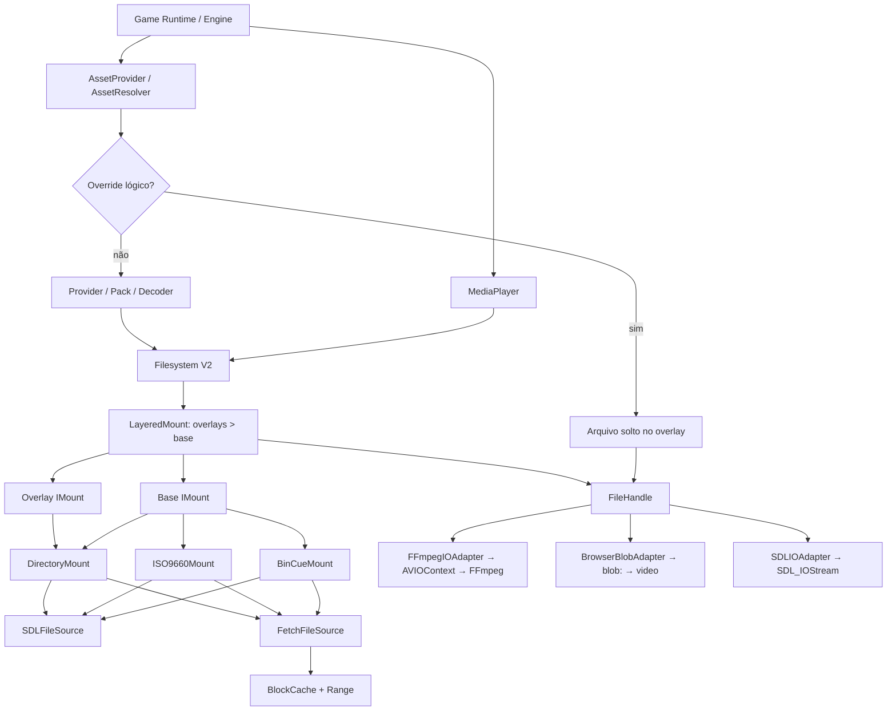
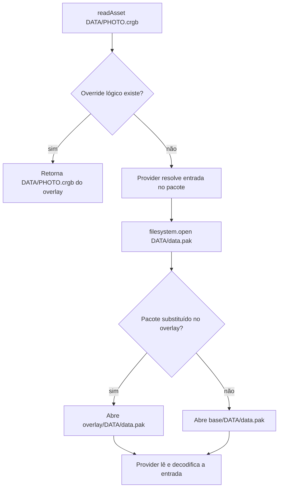

# Kotonoha Engine — Filesystem V2

> **Documento de implementação para agente de IA / engenheiro C++**  
> **Estado:** especificação de arquitetura e plano de migração; **não** significa que as APIs aqui propostas já existam.  
> **Repositório:** https://github.com/Ruaneri-Portela/Kotonoha  
> **Local recomendado dentro do repositório:** `docs/filesystem/README.md`  
> **Objetivo:** consolidar a leitura dos recursos do motor em um Filesystem virtual, independente da origem, com overlays em dois níveis, montagem de arquivos de disco, leitura por SDL3/Fetch e adaptadores para FFmpeg e navegador.

---

## 0. Instruções obrigatórias para o agente implementador

Este documento é uma **especificação de produto e arquitetura**, não um patch pronto. Antes de editar o projeto:

1. **Inspecione a árvore real do checkout**, as assinaturas atuais e os respectivos chamadores. Não invente paths nem presuma que classes ou funções deste documento já existem.
2. Leia `README.md`, `docs/ASSET_OVERLAYS.md`, `docs/DIRECTORY_POLICY.md`, `lib/include/Kotonoha/core/FileSystem.hpp`, sua implementação e os testes relacionados. Confira também a documentação de WebAssembly e os projetos Xcode/Android.
3. Localize os `AssetProvider`, `FileSystemAssetProvider`, `IndexedFileSystemAssetProvider`, `MediaPlayer`, leitores ISO/PS2, `SummerAssets`, `Pack` e inicializações dos jogos usando `rg`/busca estrutural. Registre a localização **efetiva** de cada um no checkout.
4. **Reutilize código existente** de leitura ISO, resolução de caminhos e overlays. Não crie outra implementação paralela dos mesmos comportamentos.
5. Trabalhe em fases pequenas, cada uma compilável/testável. Não remova um contrato público antes de migrar os chamadores e adicionar testes equivalentes.
6. Preserve a formatação do projeto (`.clang-format`, `.editorconfig`); não reformate bibliotecas vendorizadas nem altere assets comerciais.
7. Quando a especificação exigir algo que o checkout atual contradiz, documente a diferença, proponha a menor adaptação compatível e valide com testes. **Não marque como concluído o que não foi implementado e testado.**
8. Ao final de cada fase, entregue: arquivos alterados, APIs novas/removidas, comandos de build/teste executados, resultados, limitações e tarefas restantes.

**Prioridade dos contratos:** segurança e integridade de dados > regras de overlay existentes > API síncrona exigida pelo projeto > compatibilidade dos ports > otimizações.

### Fontes de referência existentes

- [README principal](https://github.com/Ruaneri-Portela/Kotonoha/blob/main/README.md) — estrutura do motor, plataformas, portas de jogos e política atual de ISO.
- [Contrato de overlays](https://github.com/Ruaneri-Portela/Kotonoha/blob/main/docs/ASSET_OVERLAYS.md) — precedência de overrides, nomes lógicos, aliases, cache e segurança.
- [Política de diretórios](https://github.com/Ruaneri-Portela/Kotonoha/blob/main/docs/DIRECTORY_POLICY.md) — roots por plataforma e separação entre assets e saves.
- [Header atual de paths/storage](https://github.com/Ruaneri-Portela/Kotonoha/blob/main/lib/include/Kotonoha/core/FileSystem.hpp).
- [Implementação atual de paths/storage](https://github.com/Ruaneri-Portela/Kotonoha/blob/main/lib/src/core/FileSystem.cpp).
- [Exemplo oficial FFmpeg custom AVIO](https://github.com/FFmpeg/FFmpeg/blob/master/doc/examples/avio_read_callback.c).

**Observação de escopo:** a documentação pública do repositório foi consultada ao preparar este plano, mas nem todos os `.cpp` dos providers/media foram auditados linha a linha. O agente deve completar essa auditoria local antes de escolher os pontos exatos de alteração.

---

## 1. Objetivo e princípios inegociáveis

Implementar `Kotonoha::Filesystem::Filesystem` como **única abstração de leitura dos dados de jogo**.

- O Filesystem recebe **uma origem**: diretório local, arquivo local montável, diretório HTTP com índice, ou arquivo remoto montável.
- Origens locais são normalizadas para paths locais absolutos; origens remotas para URLs absolutas (sem confundir URL com `std::filesystem::path`).
- I/O de arquivos locais usa **SDL3 (`SDL_IOStream`)**; não implementar o backend local com `std::ifstream`/`FILE*`/POSIX `read` diretamente. `std::filesystem` pode auxiliar em paths, metadados e validação de diretórios locais conforme o projeto.
- I/O de HTTP usa **Fetch** no Emscripten, preferencialmente `Range` para arquivos grandes; não depender do Emscripten VFS/preload como fundamento da camada remota.
- A **interface pública C++ de leitura e seek é síncrona**. O mecanismo que a faz funcionar com Fetch deve respeitar as restrições de execução do navegador; nunca fingir que `fetch()` do JS é bloqueante na main thread.
- Uma ISO ou BIN/CUE expõe **arquivos virtuais** (`open`, `stat`, `list`, `exists`) sem extrair a imagem inteira. Montadores trabalham sobre fontes genéricas de bytes.
- Providers interpretam CMP/PAK/RPA/DAT e os formatos dos jogos. O Filesystem **não conhece os formatos proprietários** de assets.
- Overlays formam **uma segunda árvore com o mesmo layout de `game-assets`**, visível em **dois pontos**: substituição de asset lógico e substituição de arquivo-fonte.
- O FFmpeg de arquivos gerenciados pelo motor usa exclusivamente **`AVIOContext`** derivado de `FileHandle`; **não** recebe path físico ou URL de origem.
- O `HTMLVideoElement` recebe uma URL **`blob:`** produzida de bytes vindos do `FileHandle`, **não** a URL HTTP original.
- Saves/configurações/documentos permanecem sob a política de armazenamento persistente existente, **fora do overlay de assets**, sem escrita pelo VFS na primeira versão.
- Cada arquivo virtual pode não ter path no sistema operacional. Não oferecer `std::filesystem::path` como representação universal de um asset.

### Não objetivos da primeira versão

- Escrita/edição de ISOs ou de arquivos internos aos montadores.
- Sistema genérico de montagem de qualquer formato proprietário.
- Substituir codecs ou decodificadores.
- Garantir streaming HTTP seekable em servidores sem suporte a Range.
- Recarregamento a quente de todos os pacotes e caches sem política explícita.
- Suporte UDF, áudio CD completo, todos os modos RAW de disco, ZIP/7z ou TAR antes dos marcos básicos.
- Converter `.mpg` em algo que o navegador suporte apenas colocando bytes num Blob.

---

## 2. Visão de arquitetura



**Separações conceituais:**

| Componente | O que sabe | O que não deve saber |
|---|---|---|
| `StoragePaths` | roots de recursos, game-assets, documentos e saves por plataforma | conteúdo de ISO, pacotes, rede |
| `Path`/`PathResolver` | normalização e validação de paths virtuais | como o asset é codificado |
| `IFileSource` | abrir um recurso de bytes (SDL/Fetch) | estrutura de ISO/CMP |
| `IMount` | indexar/expor árvore virtual de arquivos | quem consome o conteúdo |
| `LayeredMount` | precedência e mesclagem da árvore de fontes | IDs lógicos de arquivos internos de pacotes |
| `FileHandle` | read/seek/tell/size | URL original ou decoder |
| `AssetProvider` | formatos específicos e resolução de assets lógicos | implementação física de Fetch/SDL |
| `FFmpegIOAdapter` | callbacks AVIO e ownership | origem física do arquivo |
| `BrowserBlobAdapter` | transferência de bytes e ciclo de vida de Blob | de qual ISO o arquivo veio |

---

## 3. Estrutura-alvo dos arquivos

**Estrutura proposta; criar somente os módulos efetivamente necessários em cada fase.** Ajustar os nomes ao estilo do checkout, mantendo responsabilidade inequívoca.

```text
lib/
├── include/Kotonoha/
│   └── Filesystem/
│       ├── README.md                   # opcional: resumo do módulo
│       ├── Filesystem.hpp
│       ├── FileHandle.hpp
│       ├── FileInfo.hpp
│       ├── FilesystemError.hpp
│       ├── Path.hpp
│       ├── StoragePaths.hpp           # antigo core/FileSystem.hpp, renomeado
│       ├── IFileSource.hpp
│       ├── IMount.hpp
│       ├── SourceDetector.hpp
│       ├── MountRegistry.hpp
│       ├── Sources/
│       │   ├── SDLFileSource.hpp
│       │   └── FetchFileSource.hpp
│       ├── Mounts/
│       │   ├── DirectoryMount.hpp
│       │   ├── RemoteDirectoryMount.hpp
│       │   ├── ISO9660Mount.hpp
│       │   ├── BinCueMount.hpp
│       │   ├── LayeredMount.hpp
│       │   └── TarMount.hpp           # futuro
│       ├── Cache/
│       │   ├── BlockCache.hpp
│       │   └── CachePolicy.hpp
│       └── Adapters/
│           ├── SDLIOAdapter.hpp
│           ├── FFmpegIOAdapter.hpp
│           └── BrowserBlobAdapter.hpp
└── src/
    └── Filesystem/
        ├── Filesystem.cpp
        ├── Path.cpp
        ├── StoragePaths.cpp
        ├── SourceDetector.cpp
        ├── MountRegistry.cpp
        ├── Sources/...
        ├── Mounts/...
        ├── Cache/...
        └── Adapters/...
```

### Regra de nomenclatura para o header legado

Mover **conceitualmente** `lib/include/Kotonoha/core/FileSystem.hpp` e `lib/src/core/FileSystem.cpp` para `Filesystem/StoragePaths.hpp/.cpp`.

O header atual publica, entre outros, `StoragePlatform`, `StorageLocations`, `DirectoryLayout`, `directoryLayout`, `applicationDirectories`, `referenceCandidates`, `resourceDirectory`, `gameAssetDirectory`, `preferredDataDirectory`, `saveDirectory`, `documentsDirectory`, `FileResolver` e `writeTextFileAtomically`.

**Atenção:** esse conjunto também contém helpers de lookup de fontes e até APIs para fontes. O agente deve decidir se algumas funções merecem classes separadas (`ResourceLocator`, `FontResources`) **sem ampliar o escopo da primeira migração**. A decisão inicial é manter todas as funcionalidades e comportamentos na nova unidade `StoragePaths`, sem reescrever a política.

Migração segura:

1. Criar `Kotonoha/Filesystem/StoragePaths.hpp` e mover a implementação correspondente.
2. Preservar **temporariamente** os símbolos existentes em `namespace Kotonoha` para evitar mudança binária em massa. Opcionalmente adicionar uma facade `Kotonoha::Filesystem::StoragePaths` delegando às funções antigas.
3. Tornar `<Kotonoha/core/FileSystem.hpp>` um header *shim* de compatibilidade, incluindo o novo header; evitar duas implementações/definições.
4. Atualizar includes paulatinamente; só remover o shim quando todos os alvos/ports e testes estiverem migrados.
5. **Não** confundir `StoragePaths` (política de paths e saves) com `Filesystem` (montagem/leitura virtual).

---

## 4. Contratos mínimos de C++ (propostas, não APIs existentes)

### 4.1. Identificação de paths e arquivos

Todos os caminhos de `IMount` são **relativos à raiz virtual**, usando `/`, sem prefixo `/`, sem `..` e com uma única representação normalizada. Diretórios usam `""` como raiz virtual. Evitar vazamento de paths físicos através da API.

```cpp
namespace Kotonoha::Filesystem {

enum class SeekOrigin { Begin, Current, End };
enum class FileType { Regular, Directory };

struct FileInfo {
    std::string path;  // caminho virtual normalizado
    FileType type;
    int64_t size = -1; // -1 se indisponível
};

class FileHandle {
public:
    virtual ~FileHandle() = default;
    virtual int64_t read(void* dst, size_t count) = 0;
    virtual int64_t seek(int64_t offset, SeekOrigin origin) = 0;
    virtual int64_t tell() const = 0;
    virtual int64_t size() const = 0;
};

} // namespace Kotonoha::Filesystem
```

**Semântica obrigatória:** `read()` retorna `>0` bytes lidos, `0` apenas em EOF, `<0` para erro (ou adotar um tipo explícito de erro equivalente); nenhuma leitura remota fracassada é convertida em EOF. `seek()` retorna posição absoluta em sucesso e erro em caso de offset inválido. `size()` devolve tamanho válido ou erro claramente tipado. Tratar overflow e arquivos >2 GiB. Handles são independentes e RAII; montagens/fontes compartilham ownership suficiente para sobreviver enquanto qualquer handle estiver aberto.

**Opção de arquitetura preferível para montadores:** uma fonte de bytes com `readAt(offset, ...)` e tamanho é útil para ISO sem interferir na posição de outros leitores. Um `FileHandle` com cursor é apresentado ao consumidor e traduz `read` para `readAt` no backend. Se o agente preferir outra composição, deve garantir a mesma independência e testar leitura concorrente.

### 4.2. Montagem

```cpp
class IMount {
public:
    virtual ~IMount() = default;
    virtual bool exists(std::string_view path) const = 0;
    virtual FileInfo stat(std::string_view path) const = 0;
    virtual std::vector<FileInfo> list(std::string_view dir) const = 0;
    virtual std::unique_ptr<FileHandle> open(std::string_view path) const = 0;
};

class Filesystem {
public:
    static std::shared_ptr<Filesystem> mount(std::string source);
    void addOverlay(std::string source, int priority = 100);
    bool exists(std::string_view path) const;
    FileInfo stat(std::string_view path) const;
    std::vector<FileInfo> list(std::string_view dir) const;
    std::unique_ptr<FileHandle> open(std::string_view path) const;
    // API complementar de consulta exclusiva aos overlays lógicos.
    std::unique_ptr<FileHandle> tryOpenLogicalOverride(std::string_view id) const;
};
```

**`tryOpenLogicalOverride()` é uma proposta funcional**, não um nome obrigatório. Ela deve consultar **somente as camadas de overlay**; jamais a base. Sem uma API equivalente, o asset lógico original solto em `game-assets` poderia ser tratado acidentalmente como override e pular o provider.

**Evitar ambiguidade de montagem:** `mount(source)` deve permitir diretório ou arquivo reconhecido. Se source for um arquivo comum não montável, retornar um erro `UnsupportedMount` em vez de tratá-lo silenciosamente como pasta. Um modo opcional futuro poderá expor um único arquivo como root.

### 4.3. Falhas e mensagens

Criar códigos distinguíveis, por exemplo: `NotFound`, `NotDirectory`, `IsDirectory`, `InvalidPath`, `PermissionDenied`, `UnsupportedMount`, `CorruptImage`, `RangeUnsupported`, `NetworkError`, `UnexpectedEOF`, `Canceled`, `WouldBlock`, `IOError`.

Não deixar `exists()` mascarar falhas de rede como “arquivo inexistente” em situações onde isso mudaria a precedência. O agente pode usar exceções ou `expected`/resultado tipado, conforme padrão já estabelecido pelo engine, mas precisa garantir que o chamador diferencia **ausência** de **erro**.

---

## 5. O overlay de dois níveis é requisito central

### 5.1. Modelo de diretórios

```text
game-assets/
└── DATA/
    └── data.pak           # arquivo-fonte original

overlay/
└── DATA/
    ├── PHOTO.crgb         # override lógico, asset individual
    └── data.pak           # override físico/virtual do pacote inteiro
```

O overlay é **uma segunda estrutura `game-assets`**. O mesmo arquivo da árvore de overlay pode participar tanto da resolução lógica de assets quanto da resolução de fontes; ele é montado **uma vez** e consultado por ambos os caminhos.

### 5.2. Algoritmo de resolução de asset

Ao pedir `DATA/PHOTO.crgb`:

1. Normalizar o ID lógico e aplicar os aliases existentes do provider/engine.
2. Consultar o **overlay lógico**: `overlay/DATA/PHOTO.crgb`.
3. Se existe, entregar os bytes do override e decodificar no fluxo correspondente ao tipo real do arquivo. Preservar a regra existente de tentar decoders usuais de imagem/áudio quando o ID lógico tem extensão nativa.
4. Se não existe, chamar o provider nativo para resolver o asset.
5. O provider solicita o arquivo-fonte (`DATA/data.pak`) por `filesystem.open()`; o **LayeredMount** escolhe `overlay/DATA/data.pak`, caso exista; senão `game-assets/DATA/data.pak`.
6. O provider indexa/descompacta/decodifica a entrada `PHOTO.crgb` do **pacote efetivamente aberto**.



**Precedência obrigatória:**

1. Arquivo lógico solto no overlay.
2. Arquivo lógico produzido pelo provider a partir do pacote substituto do overlay.
3. Arquivo lógico produzido pelo provider a partir do pacote original da base.

**Política para substituição total de pacote:** se `overlay/DATA/data.pak` existe, ele **substitui o pacote inteiro**. Uma entrada ausente nele **não** deve ser recuperada silenciosamente do `data.pak` original, a menos que o provider já tenha uma semântica documentada de mesclagem por entradas. Isso evita misturar índices de pacotes diferentes. Overrides lógicos soltos continuam funcionando acima de ambos.

### 5.3. Overlay lógico vs. overlay de fontes

| Operação | Usa camadas | Resultado |
|---|---|---|
| `filesystem.open("DATA/data.pak")` | Overlay + base | Fonte de maior prioridade |
| `filesystem.exists("DATA/data.pak")` | Overlay + base | Presença efetiva |
| `filesystem.list("DATA")` | Overlay + base | Entradas mescladas, sem duplicatas |
| `filesystem.tryOpenLogicalOverride("DATA/PHOTO.crgb")` | **Somente overlay(s)** | Override direto ou ausente |
| `assetProvider.read("DATA/PHOTO.crgb")` | Override lógico → provider → fonte em camadas | Recurso final |

**Não colocar um parser de PAK dentro de `Filesystem::open("DATA/PHOTO.crgb")`.** Um `Filesystem` genérico não deve adivinhar que o recurso está em `DATA/data.pak`.

### 5.4. Compatibilidade com overlays existentes

Não reimplementar a lógica atual de `AssetProvider` de maneira conflitante. Preservar:

- `--asset-overlay`, `--no-asset-overlay`, seleção e persistência do launcher.
- `--scripts` como alias no port School Days onde aplicável.
- Normalização dos dois estilos de barra e de **case ASCII**; rejeição de duplicatas com nomes equivalentes.
- Rejeição de traversal, caminhos absolutos internos e links que saem do root.
- Entrada direta de overlay antes dos métodos nativos `*Asset`.
- Listagem de nomes apenas do overlay + nomes nativos; prioridade dos overrides.
- Tratamento de formatos de substituição por decoders do engine ou do port.
- Casos especiais já documentados: VNX/DDLC com arquivos soltos e pacotes traduzidos, aliases e packs `.rpx`/`.rpa`, além de RealLive/ZNT/Snow/School Days.
- Cache de textura e índices de provider devidamente invalidados na mudança de camada.

**Invariante de não regressão:** se só houver overlay lógico, o comportamento deve permanecer idêntico ao atual. O novo recurso é a **substituição dos arquivos-fonte que os providers usam internamente**.

### 5.5. Conflitos, listagens e mounts

- Arquivo substitui arquivo; diretórios de camadas diferentes são mesclados.
- Se `overlay/DATA` é arquivo e `base/DATA` é diretório, não atravessar o diretório inferior. O nó de maior prioridade governa aquele caminho.
- A entrada visível deve ter nome e tipo únicos após normalização; colisões case-insensitive na **mesma camada** são erro; colisões entre camadas são resolvidas pela prioridade.
- `stat`, `exists`, `list` e `open` precisam concordar sobre qual nó é visível.
- Não expor symlink para fora de raiz; verificar o caminho real após resolução, sem race óbvia de TOCTOU nos acessos críticos.
- Com várias camadas, definir prioridade explícita e desempate determinístico; sem política de *whiteouts* ou deleções na V1.

### 5.6. Alterações de overlay e índices

Primeiro marco: montar base e overlays **antes** de construir/indexar os providers. O provider deve abrir o pacote efetivo com a camada correta.

Se houver montagem/remontagem em runtime:

- `LayeredMount` atualiza uma **geração** monotônica.
- Providers reindexam fontes substituídas e invalidam caches derivados (assets, imagens, texturas, scripts, mídia).
- Handles já abertos seguem usando a versão montada no momento da abertura, ou uma política explícita de invalidação; não trocar bytes debaixo de um handle.
- Respeitar a política já documentada de arquivos existentes substituídos vs. nomes novos que requerem remontagem, até que um contrato novo seja deliberadamente adotado.
- Não divulgar suporte a hot-reload integral enquanto os ports ainda mantiverem índices antigos.

---

## 6. Fontes de bytes e montadores

### 6.1. SDLFileSource

- Usar `SDL_IOFromFile`, `SDL_ReadIO`, `SDL_SeekIO`, `SDL_GetIOSize`, `SDL_CloseIO`, verificando os contratos da versão SDL3 realmente fixada no projeto.
- Paths locais absolutos e normalizados; root de diretório descoberto por `StoragePaths` quando apropriado.
- Bounds checking e tamanho em 64 bits; múltiplos handles independentes.
- Segurança de symlink/raiz quando usado com diretório montado.
- Nenhum `std::ifstream` na implementação da fonte local.

### 6.2. DirectoryMount

- Mapear paths virtuais para arquivos locais sob uma raiz permitida.
- Construir índice case-insensitive **compatível com a semântica atual** quando essa política estiver ativa, rejeitando colisões.
- `list("")` lista apenas a raiz virtual.
- Não fazer leitura integral de arquivos em `open()`.

### 6.3. ISO9660Mount

- Reaproveitar parsers e regras de ISO9660/Joliet existentes.
- Ler descritores, diretórios e extents usando acesso aleatório sobre fonte; **não extrair imagem inteira**.
- Retornar handles de **subintervalo virtual** com tamanho do arquivo e offsets corretos.
- Testar diretórios aninhados, case/versões de nomes (`;1`), Joliet, arquivos vazios, leitura no EOF, leitura cruzando blocos, arquivos >2 GiB quando suportados, imagens inválidas e overflow.
- Manter compatibilidade com as imagens conhecidas dos ports; **não prometer UDF**.

### 6.4. BinCueMount

- Não concluir que todo `.bin` é imagem de disco. Confirmar layout/assinatura e, quando disponível, interpretar `.cue` e seus arquivos associados.
- Planejar setor de dados `2048`, RAW `2352` e offsets/modos conforme o port precisar. Não aplicar um offset fixo a todos os BIN.
- CUE pode referenciar mais de um BIN: resolver referências **na origem correspondente**, inclusive HTTP com manifesto; rejeitar traversal.
- Primeira implementação deve declarar exatamente os modos suportados. Para modos não suportados, retornar erro claro.
- Reaproveitar leitores Amagami/ZNT onde possível, mas não destruir sua compatibilidade antes dos testes.

### 6.5. SourceDetector e MountRegistry

- Usar extensão como **indício**, inspecionando estrutura/magic para confirmar.
- Montar diretórios diretamente; montar imagens reconhecidas; falhar de forma explícita em formatos inválidos.
- Separar detecção da criação do montador; permitir registrar TAR e outros formatos depois.
- Evitar baixar imagens remotas inteiras apenas para detectá-las: probes de tamanho limitado e `Range`.

### 6.6. Montagens encadeadas (futuro)

O design deve aceitar que um `IMount` use um `FileHandle` virtual de outro mount como origem:

```text
FetchFileSource -> Summer.iso -> ISO9660Mount
                                 -> DISC1/data.tar -> TarMount
                                                   -> movie.mpg
```

Sem comprometer a V1 com montagem recursiva automática ilimitada: aplicar limites de profundidade, tamanho e custo para prevenir arquivos maliciosos.

---

## 7. HTTP e WebAssembly

### 7.1. RemoteDirectoryMount

HTTP não possui listagem genérica de diretórios. Usar **manifesto** gerado no build/publicação (integrar com `tools/generate_manifest.py` existente, após verificar seu formato atual), contendo ao menos paths normalizados, tipos, tamanhos e URLs relativas/identificadores de origem.

- Validar versão/esquema do manifesto, rejeitando paths inválidos e duplicados.
- Nunca assumir que `https://site/game/` é um diretório listável porque termina em `/`.
- `open()` resolve o recurso pelo manifesto e delega bytes à fonte Fetch.
- Controle de CORS e cache HTTP é parte da configuração de hospedagem, não da lógica dos providers.

### 7.2. FetchFileSource

- Suportar leitura por `Range` quando aplicável, `206 Partial Content` e validação de `Content-Range`, tamanho, identidade da origem (`ETag`/`Last-Modified` quando viável) e resposta consistente.
- Definir cache de blocos por origem + versão + índice, com política de memória limitada, *coalescing* de pedidos, pré-busca opcional e limites de concorrência.
- Tratar `200 OK` para pedido de Range como **Range não suportado**; não alocar automaticamente uma ISO de vários gigabytes.
- Limitar downloads completos a arquivos pequenos conforme política **configurável**; caso contrário, falhar explicitamente com diagnóstico.
- Diferenciar timeouts, HTTP 404, erro de CORS, cancelamento e EOF.
- Recursos autenticados: não logar tokens, URLs assinadas ou cabeçalhos sensíveis.
- Evitar redirecionamentos inseguros e restrições de origem não previstas.

### 7.3. Síncrono em C++ não implica Fetch síncrono em JavaScript

Contrato público exigido:

```cpp
file->read(buffer, 4096); // retorna quando os bytes estão disponíveis ou erro
file->seek(32768, SeekOrigin::Begin);
```

**Nunca bloquear a main thread do navegador esperando a Promise de Fetch.** Abordagens possíveis, a validar com SDL3/Emscripten do checkout:

1. Worker do motor + **coordenador assíncrono separado** executando Fetch, comunicando-se por mecanismo permitido de sincronização (`SharedArrayBuffer`/`Atomics`) e exigindo isolamento `COOP`/`COEP`.
2. Transformação controlada de chamadas assíncronas em C++ via Asyncify/JSPI, com análise da integração do loop SDL e dos custos de toolchain.
3. Pré-carregamento explícito em memória antes da chamada C++ síncrona, se a origem/tamanho permitir.

Apenas colocar Fetch na mesma Worker bloqueada **não funciona**: seus callbacks precisam ter oportunidade de executar. **Não prometer uma implementação 100% síncrona no browser main thread.** A escolha deve ser registrada em ADR com experimento mínimo e teste real em navegador antes de integrar ISO remota.

### 7.4. Build web e hospedagem

- Conferir flags e runtime Emscripten atuais; não copiar flags obsoletas sem teste.
- Configurar headers COOP/COEP e CORS/Range na infraestrutura de desenvolvimento para o modelo de Workers escolhido.
- Verificar integração com `SDL3`, áudio e loop do jogo; evitar congelamento do render.
- Testar Chrome/Firefox/Safari nas versões suportadas com dados sintéticos e tamanho pequeno antes de escalar.

---

## 8. Adaptadores de I/O

### 8.1. FFmpegIOAdapter — regra obrigatória

**Para mídias de jogo controladas pelo Filesystem, FFmpeg nunca recebe um path físico ou URL real.** Recebe `AVIOContext` customizado.

```cpp
// Exemplo conceitual
std::unique_ptr<FileHandle> file = fs->open("DISC1/opening.mpg");
auto adapter = FFmpegIOAdapter::create(std::move(file));

AVFormatContext* fmt = avformat_alloc_context();
fmt->pb = adapter->context();
fmt->flags |= AVFMT_FLAG_CUSTOM_IO;
int status = avformat_open_input(&fmt, nullptr, nullptr, nullptr);
```

Exigências:

- `read_packet` adapta `FileHandle::read()`, traduzindo EOF para `AVERROR_EOF` e erros para códigos negativos apropriados.
- `seek` implementa `SEEK_SET`, `SEEK_CUR`, `SEEK_END` e `AVSEEK_SIZE`; interpretar flags de FFmpeg corretamente. Retornar posição absoluta e erro adequado; somente marcar `AVIO_SEEKABLE_NORMAL` quando suportado.
- Alocar buffer de AVIO conforme convenções FFmpeg (`av_malloc`), fazer cleanup correto (`avio_context_free`, buffer possivelmente realocado), sem double-free e sem liberar o handle antes do demuxer.
- Adapter e `FileHandle` permanecem vivos durante a leitura/seek do demuxer; fechar demuxer antes de destruir adapter.
- Fazer `avformat_open_input(..., nullptr, ...)`, com `pb` atribuído previamente. Não criar URL `file:`, `http:` ou `blob:` para FFmpeg.
- Manter o fluxo legado de `MediaPlayer::open(path)` **somente como facade de resolução via Filesystem**, durante a migração. Não permitir fallback implícito para `avformat_open_input(path.c_str(),...)` em recursos gerenciados.
- Evitar mudanças no ciclo de vida de SDL3/FFmpeg que causem problemas de thread, busca e interrupção/cancelamento da reprodução.

### 8.2. SDLIOAdapter

- Expor `FileHandle` como `SDL_IOStream` para componentes que ainda dependem da API SDL3.
- Usar `SDL_IOStreamInterface`/API de stream customizada **da versão SDL3 fixada**.
- Garantir ownership consistente: fechar stream deve liberar handle **uma só vez**. Implementar size/seek/read; modo somente leitura.
- Adaptador ajuda a migrar parsers existentes, sem exigir que todos sejam reescritos de uma vez.

### 8.3. BrowserBlobAdapter

- Receber bytes do `FileHandle`, transferir para JS e produzir `Blob` e URL via `URL.createObjectURL()`.
- `HTMLVideoElement` recebe **apenas a URL `blob:`**, nunca a URL remota original.
- MIME é informação auxiliar; usar tipo real quando conhecido. `Blob("video/mp4")` **não transmuta** MPEG-PS `.mpg` em MP4.
- Implementar ciclo de vida: manter Blob/URL vivos durante uso; ao encerrar, revogar URL com `URL.revokeObjectURL()` e liberar buffers quando seguro.
- Evitar múltiplas cópias desnecessárias e limitar memória; Blob convencional pode exigir buffering integral do vídeo. Se ultrapassar o limite configurado, usar FFmpeg ou retornar impossibilidade explícita.
- Browser playback e FFmpeg são **estratégias diferentes de apresentação** que utilizam o mesmo `FileHandle`.
- Uma alternativa futura de streaming (ex.: MediaSource quando o contêiner/codecs permitirem) é um adaptador separado, não um Blob que magicamente implemente seek sob demanda.

---

## 9. Integração com AssetProvider e ports

### 9.1. Não substituir o contrato público atual sem justificativa

O contrato existente já garante que métodos públicos do provider verifiquem overrides antes de chamar métodos nativos `*Asset`. **Preservar esse wrapper** e fazer sua consulta de override usar a visão lógica do Filesystem. A API exata e a estratégia de decoders devem ser auditadas no checkout.

Para os providers nativos, mudar **a origem dos bytes**:

```cpp
// Antes (exemplo representativo, não transcrição exata)
Pack pack(std::filesystem::path("DATA/data.pak"));

// Depois (API proposta)
Pack pack(filesystem.open("DATA/data.pak"));
```

O primeiro constructor `Pack` pode continuar existindo por compatibilidade, delegando ao novo stream; ele não deve ser usado pelos providers migrados como requisito fundamental.

**Caminho crítico para qualquer provider que indexe pacotes no construtor:** fornecer o Filesystem com overlays já montados **antes** do construtor criar o índice. Só chamar `filesystem.open()` numa etapa tardia não substitui pacotes que já foram abertos e indexados.

### 9.2. SummerRadish como piloto

Migrar a lógica previamente identificada em `SummerAssets`:

- Resolver `DISC1/PACK` ou `PACK` por `exists/isDirectory/list`, sem `std::filesystem::directory_iterator` sobre game-assets.
- Encontrar `INI.CMP`, `SCRIPT.CMP`, `GRAPHIC.CMP`, `SOUND.CMP`, `VOICE.CMP` por listagem virtual e resolução case-insensitive compatível.
- Alterar `Pack` para receber `FileHandle`/`SDL_IOStream` adaptado; manter cursor e `seek` corretos.
- Abrir vídeos por ID relativo e `FileHandle`; eliminar dependência do `moviePath()` que exige path físico.
- Evitar `DISC1/DISC1` quando a raiz efetiva já aponta para `DISC1`; não proibir subpaths legítimos como `DISC1/opening.mpg`.
- Demonstrar quatro configurações: pasta; ISO local; pasta + overlay de CMP; pasta/ISO + overlay direto de asset.

### 9.3. Outros ports

Auditar e migrar de modo incremental:

- **RealLive:** manter leitura ISO9660/Joliet direta e overlays; reaproveitar o parser existente. Nada de regressão em `Seen.txt`, `Gameexe.ini`, imagens e vozes.
- **Amagami e Zero:** aproveitar parsers de imagens/raw-disc existentes, sem uniformização apressada de layouts distintos de setor.
- **DDLC/VNX:** manter arquivos soltos, `.rpa`, `.rpx`, aliases e precedência já documentada.
- **School Days:** manter `--scripts`, traduções e decodificação KTRF/ORS.
- **Snow, Kirikiri, LucaSystem, Pure Mail e demais ports:** preservar `game-assets`, jogos com subpastas e semântica de lookup do provider.

A lista é um **roteiro de auditoria**. O agente deve confirmar no checkout o conjunto de ports efetivamente habilitados e seus arquivos.

### 9.4. MediaPlayer

Criar overload de entrada de `FileHandle` e encaminhar para FFmpeg ou BrowserBlobAdapter conforme formato/suporte/estratégia escolhida. Suportar chamadas existentes por path via adaptador de compatibilidade, **resolvendo via Filesystem**, e atualizar os chamadores gradualmente.

Se houver `MediaPlayer` com fontes externas legítimas (ex.: streams não pertencentes ao game-assets), definir uma API separada e explícita, sem contaminar a regra de AVIO para os arquivos administrados pelo motor.

---

## 10. Integração com StoragePaths, saves e launcher

O módulo antigo de paths **não é um Filesystem virtual**. Ele descobre roots e aplica políticas por plataforma. A nova sequência de inicialização deve ser:

```text
StoragePaths / FileResolver
   ├── localiza instalação selecionada pelo launcher
   ├── localiza overlay selecionado/lembrado
   └── localiza raízes de saves/configs
                 │
                 ▼
        Filesystem::mount(base)
                 │
                 ▼
        Filesystem::addOverlay(overlay)
                 │
                 ▼
      Construir providers e índices
                 │
                 ▼
           Iniciar runtime
```

- Preservar identidade de saves baseada em package ID, jamais nome visível do jogo.
- Não reclassificar saves/documentos como `game-assets`; nenhum overlay poderá esconder saves.
- Manter `writeTextFileAtomically` e outras operações de persistência sob a política de armazenamento existente.
- Opções do launcher e CLI continuam escolhendo **origens**; só depois o Filesystem normaliza e monta.
- Não mudar comportamento de bundle macOS/iOS, Android OBB e roots alternativos sem comparar com `docs/DIRECTORY_POLICY.md`.

---

## 11. CMake, Xcode, Android e CI

### CMake

- Identificar targets concretos da engine/biblioteca antes de adicionar `.cpp`.
- Registrar núcleo de Filesystem e montadores em targets portáveis; evitar duplicação de compilação por jogo.
- FFmpegIOAdapter compilado/ligado apenas quando FFmpeg estiver disponível no alvo.
- FetchFileSource e BrowserBlobAdapter somente no build Emscripten.
- Evitar headers FFmpeg ou Emscripten no `Filesystem.hpp` público.
- Preservar flags, padrão C++ e integração com submodules/vcpkg atuais.

### Xcode nativo

- Conferir `buildsystems/xcode/Kotonoha.xcodeproj` e o script gerador/atualizador efetivamente usado no checkout.
- Registrar novos `.hpp/.cpp` em grupos e targets da engine. Não depender exclusivamente de glob CMake: o projeto iOS nativo não executa CMake na compilação.
- Manter a organização modular, sem inserir o Filesystem dentro de grupos de providers/VM.

### Android

- Garantir que o SDLFileSource consiga acessar as raízes que os builds reais disponibilizam. Android OBB/assets de APK nem sempre se comportam como paths POSIX comuns.
- Preservar identidade do app e os diretórios de save.
- Não introduzir leitura remota por Fetch em builds nativos Android sem uma implementação deliberada de HTTP nativo.

### Testes e CI

- Adicionar fixtures **sintéticas e redistribuíveis**: pequenos pacotes de teste, ISO9660, diretório, overlay, manifesto HTTP e vídeo compatível de teste.
- Não copiar jogos ou mídias comerciais para o repositório.
- Rodar `ctest` no build do motor e smoke tests de ports suportados; adicionar teste de navegador para o backend Fetch/Blob.

---

## 12. Plano de execução em marcos verificáveis

| Marco | Implementar | Pronto quando |
|---|---|---|
| **M0 — Auditoria** | Mapear uso de paths/overlays/ISO/media, registrar dependências reais | Relatório de arquivos/callers e testes-base, sem alterar contratos |
| **M1 — StoragePaths** | Mover/renomear módulo antigo com shim compatível | Todos os usos antigos compilam e políticas de saves permanecem idênticas |
| **M2 — I/O local** | FileHandle, SDLFileSource, DirectoryMount, Path | read/seek/stat/list locais e segurança passam nos testes |
| **M3 — Camadas** | LayeredMount e `tryOpenLogicalOverride` | Overlay direto + fonte substituída + listagem mesclada |
| **M4 — ISO** | SourceDetector, ISO9660Mount sem extração | ISO local abre arquivo arbitrário e mídia por stream |
| **M5 — Providers** | SummerAssets/Pack e shared AssetProvider | CMP de base/overlay e asset lógico override, sem regressões |
| **M6 — FFmpeg/SDL** | FFmpegIOAdapter, SDLIOAdapter, MediaPlayer | Reprodução/seek/EOF sem path/URL para FFmpeg |
| **M7 — Web** | RemoteDirectoryMount, Fetch, cache, Blob | Diretório/ISO HTTP e `blob:` testados no navegador |
| **M8 — BIN/CUE e ports** | Montador RAW conforme modos necessários e migração dos demais jogos | Testes por jogo/plataforma, sem extração legado para ISO suportada |
| **M9 — Limpeza** | Remover caminhos legados só após migração | CMake/Xcode/Android/Web e documentação atualizados |

**Ordem flexível:** se uma dependência de ports exigir SDLIOAdapter antes de ISO, antecipá-lo. Não atrasar M0 nem antecipar remoção das APIs legadas.

---

## 13. Casos de teste obrigatórios

### Operações genéricas

- [ ] Abrir diretório local absoluto e relativo (normalização absoluta da origem).
- [ ] `open`, `exists`, `stat`, `list` concordam entre si.
- [ ] Handles independentes sobre o mesmo arquivo; leitura concorrente sem compartilhamento indevido de cursor.
- [ ] `seek` Begin/Current/End, EOF, arquivo vazio, offset negativo, tamanho grande, erro de leitura e truncamento.
- [ ] Paths `../`, absolutos dentro de mount, barras invertidas, caracteres inválidos, colisões case-insensitive e links fora da raiz rejeitados.
- [ ] Montagem de arquivo inválido gera erro de formato, não fallback silencioso.

### Overlay: **duas semânticas**

- [ ] `DATA/PHOTO.crgb` solto no overlay ganha do asset do pacote.
- [ ] `DATA/data.pak` do overlay é aberto pelo provider em lugar do original.
- [ ] Quando ambos existem, `PHOTO.crgb` direto ganha sobre a entrada do PAK substituto.
- [ ] Se o overlay não contém nenhum dos dois, fallback integral para a base.
- [ ] Pacote substituto sem entrada não mistura automaticamente a entrada original.
- [ ] `list` mescla diretórios com precedência estável; conflitos arquivo/diretório resolvidos corretamente.
- [ ] Um override lógico não é confundido com um loose file da base.
- [ ] Índices e caches são criados sobre a montagem efetiva; remontagem não deixa índice antigo ativo.
- [ ] CLI/launcher/aliases de overlays existentes não mudam.

### ISO/BIN

- [ ] ISO local sem extração abre subdiretórios/arquivos corretamente.
- [ ] ISO remota lê regiões específicas via Range, sem download integral involuntário.
- [ ] Joliet e normalização de nomes continuam compatíveis.
- [ ] CUE multi-BIN resolve companions sem traversal; setores/modos suportados são explicitados.
- [ ] Imagem truncada/corrupta não causa out-of-bounds, malloc ilimitado ou loop infinito.

### Media

- [ ] FFmpeg recebe somente `AVIOContext`; nenhum path/URL real em `avformat_open_input` para mídia do jogo.
- [ ] Read callback diferencia EOF/erro; seek suporta `AVSEEK_SIZE`.
- [ ] Start/stop/reabrir/falha parcial de FFmpeg sem leak/double free.
- [ ] `.mpg` que o navegador não suporta não é falsamente declarado compatível por MIME.
- [ ] `HTMLVideoElement` usa URL `blob:` e esta é revogada quando segura.

### Web

- [ ] Manifesto remoto válido/invalidado/ausente.
- [ ] Servidor com 206 Range e sem Range (200), 404, timeout, CORS e queda de rede.
- [ ] A thread principal não congela durante leitura.
- [ ] Cache respeita orçamento; falha de rede não vira EOF.
- [ ] Ferramenta de geração de manifesto continua compatível com o web build.

### Build e regressão

- [ ] Build desktop e `ctest --output-on-failure`.
- [ ] Build Xcode nativo em schemes relevantes.
- [ ] Build Android e web onde toolchains estiverem disponíveis.
- [ ] Regression tests existentes de DDLC/VNX, RealLive, Snow, ZNT, School Days e SummerRadish não regrediram.
- [ ] Saves continuam nos roots originais; nenhum dado de usuário foi alterado.

---

## 14. Critérios globais de aceite

A tarefa só está concluída quando:

1. Um mesmo provider abre arquivos sem saber se vieram de pasta, ISO local ou backend remoto suportado.
2. Overlay lógico e overlay de **arquivo-fonte** funcionam simultaneamente, inclusive para pacotes indexados no início do jogo.
3. O código de providers **não exige** `std::filesystem::path` real para abrir um arquivo virtual.
4. Não existe extração integral de ISO suportada como condição para o jogo ler seus arquivos.
5. O FFmpeg consome mídia de jogo **somente por AVIOContext**.
6. O navegador consome bytes de `FileHandle` e recebe `blob:` quando usado o backend HTML5; a URL HTTP original permanece exclusivamente no Fetch.
7. O contrato de `AssetProvider` do documento `docs/ASSET_OVERLAYS.md` foi preservado.
8. A política de saves e descoberta de diretórios permaneceu intacta após a migração para `StoragePaths`.
9. Cada target relevante compila, os testes de regressão passam e as limitações de cada montador/backend estão documentadas.
10. Todas as implementações usam ownership RAII claro, sem leaks, use-after-free, data races ou erros silenciosos.

---

## 15. Comandos úteis de auditoria para o agente

Executar na raiz do checkout, ajustando padrões às classes que realmente existirem:

```bash
rg -n 'core/FileSystem\.hpp|FileResolver|directoryLayout|saveDirectory|gameAssetDirectory' lib games buildsystems
rg -n 'AssetProvider|FileSystemAssetProvider|IndexedFileSystemAssetProvider|asset-overlay|setAssetOverlay' lib games docs
rg -n 'ISO9660|Joliet|extract.*iso|\.iso|\.cue|\.bin' lib games
rg -n 'SDL_IO|SDL_RW|ifstream|fopen|directory_iterator|std::filesystem::path' lib/src games
rg -n 'MediaPlayer::open|avformat_open_input|avio_alloc_context|AVIOContext|webUrlForPath|Blob|createObjectURL' lib games
rg -n 'EMSCRIPTEN|Asyncify|JSPI|FETCH|manifest.json|generate_manifest' . --glob '!build/**' --glob '!outputs/**'
```

**Não transformar a saída dessas buscas em uma substituição textual global.** Conferir os invariantes de cada call site, format-specific indexer, thread de mídia e ciclo de vida.

---

## 16. Formato esperado da entrega do agente

Ao concluir uma fase, relatar em Markdown:

```text
### Fase Mx — nome
- Estado: concluída / parcial / bloqueada
- Arquivos existentes modificados:
- Arquivos novos:
- Assinaturas públicas alteradas:
- Impacto nos providers e media:
- Overlays: testes e precedência comprovados:
- Comandos de build/teste e resultado:
- Plataformas não verificadas e motivo:
- Problemas/limitações remanescentes:
- Próxima fase:
```

Se não houver ambiente/toolchain para uma plataforma, marcar **não testada**, não “funcionando”. Não inserir dados comerciais em fixtures. Fazer commits pequenos por marco quando isso estiver autorizado no fluxo de trabalho do repositório.

---

## 17. Exemplo operacional final esperado

```cpp
// Pseudocódigo arquitetural; ajustar APIs reais ao projeto.
namespace KFS = Kotonoha::Filesystem;

// A política de paths descobre raízes; não abre arquivos da ISO.
auto source = Kotonoha::FileResolver::resolve("Summer.iso");
auto overlay = Kotonoha::findAssetOverlayDirectory();

// Uma árvore de leitura: overlay > base.
auto filesystem = KFS::Filesystem::mount(source.string());
if (!overlay.empty())
    filesystem->addOverlay(overlay.string());

// Montar tudo antes dos índices de pacotes.
auto assets = std::make_unique<SummerAssets>(filesystem);

// 1) Antes do provider, o wrapper consulta override lógico:
//    overlay/DATA/PHOTO.crgb (se existir).
// 2) Caso contrário, o provider pede DATA/data.pak:
//    overlay/DATA/data.pak (se existir), senão a fonte base.
// 3) O provider lê e decodifica PHOTO.crgb dentro do pacote escolhido.

// MediaPlayer recebe um handle, não uma URL/path.
auto movie = filesystem->open("DISC1/opening.mpg");
mediaPlayer.open(std::move(movie));
```

**Este exemplo descreve o comportamento desejado**; não assumir que `SummerAssets`/`MediaPlayer` já possuam essas assinaturas.

### Frase-resumo para implementar corretamente

> **StoragePaths descobre onde os recursos e saves ficam; Filesystem monta e lê a árvore efetiva; LayeredMount substitui arquivos-fonte; o wrapper do AssetProvider substitui assets lógicos; os providers interpretam pacotes; FFmpegIOAdapter e BrowserBlobAdapter adaptam os mesmos FileHandles para reprodução.**

---

## 18. Checklist rápido de proibições

- **Não** chamar `std::ifstream` na fonte SDL local.
- **Não** retornar path físico como requisito de `AssetProvider`/`MediaPlayer`.
- **Não** entregar URL HTTP ou path físico de assets gerenciados ao FFmpeg.
- **Não** entregar URL HTTP original ao `HTMLVideoElement` no caminho Blob.
- **Não** implementar `Filesystem::open(asset lógico)` procurando dentro de PAK/CMP.
- **Não** tratar erros de HTTP como EOF/asset ausente.
- **Não** bloquear a thread principal do navegador com Fetch.
- **Não** extrair ISOs inteiras como implementação de `ISO9660Mount`.
- **Não** misturar saves/configurações à camada de overlays de assets.
- **Não** alterar formato, índices, aliases e caches de providers sem testes comparativos.
- **Não** remover suporte de port ou funcionalidade legada sem alternativa testada.

**Fim da especificação.**